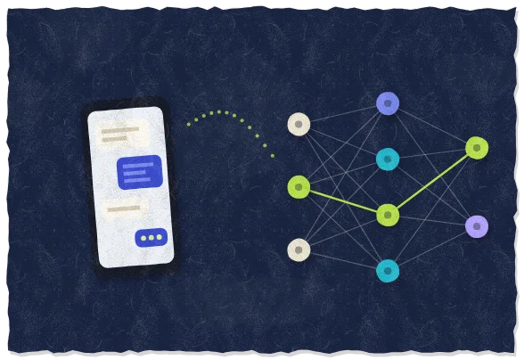
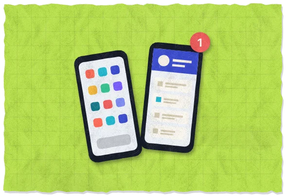
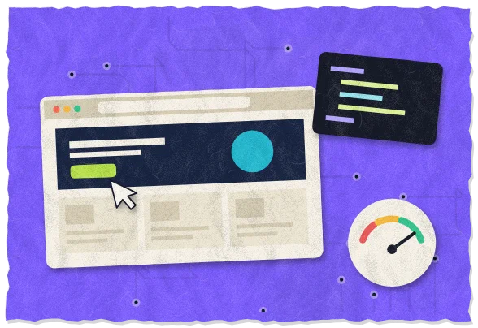
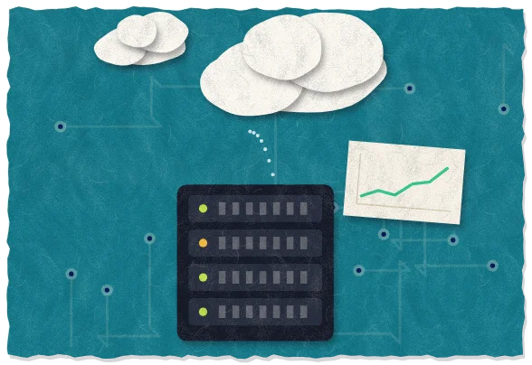
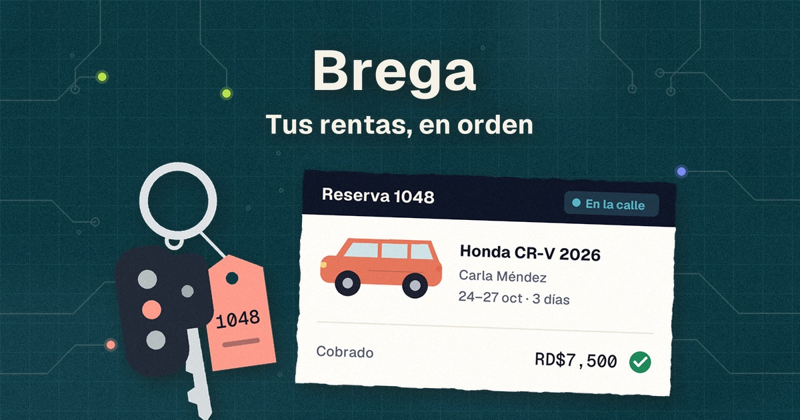
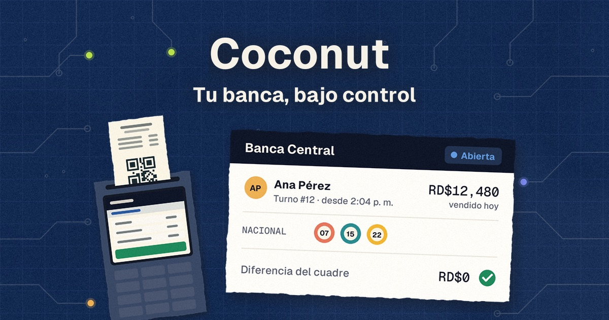
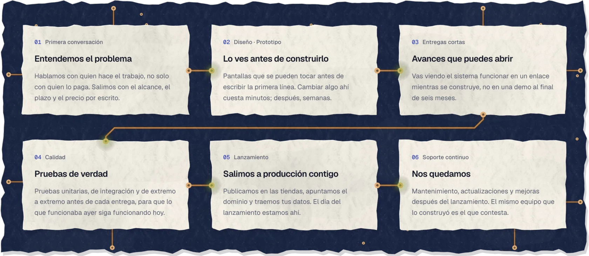

##  Hola, soy Gabriel

Soy **co-founder de [Neurosoft](https://neurosoft.dev)**, una empresa de desarrollo de sistemas e inteligencia artificial con oficinas en Santiago, República Dominicana, y en Whitehall, Pennsylvania, Estados Unidos. Hacemos chatbots con IA, aplicaciones móviles y web, y la nube donde corren. Los hacemos a la medida de cada negocio, con un equipo que **sigue ahí después del lanzamiento**.

`📍 Santiago, RD` · `📍 Whitehall, PA, EE. UU.` · `🗣️ Español · English` · `🕘 Lun–Vie, 9:00–18:00`

---

## Lo que construimos

<table>
  <tr>
    <td width="50%" valign="top">
       
      <b>Chatbots e IA</b> 
      <b>Un asistente que atiende por ti</b> 
      En WhatsApp, en tu web o en Instagram: contesta lo de siempre, toma pedidos y citas a cualquier hora y le pasa a una persona lo que no sabe. Responde con tus datos, no con respuestas genéricas.
    </td>
    <td width="50%" valign="top">
       
      <b>Aplicaciones móviles</b> 
      <b>Tu app en el teléfono de tus clientes</b> 
      En App Store y Google Play, con tu nombre. Para comprar, reservar o seguir pedidos, o para tu equipo en la calle. Con notificaciones y funcionamiento sin conexión.
    </td>
  </tr>
  <tr>
    <td width="50%" valign="top">
       
      <b>Aplicaciones web</b> 
      <b>El sistema donde trabaja tu equipo</b> 
      Inventario, pedidos, reservas, cobros: lo que hoy vive en un Excel y en tres grupos de WhatsApp, en el navegador y sin instalar nada.
    </td>
    <td width="50%" valign="top">
       
      <b>Nube</b> 
      <b>Lo que lo sostiene, sin caerse</b> 
      Servidores, bases de datos y copias de seguridad en AWS, Azure o Google Cloud, con monitoreo y despliegues automáticos.
    </td>
  </tr>
</table>

---

## Nuestros productos

Además de lo que hacemos a la medida, en Neurosoft tenemos **productos propios**: el mismo trabajo, listo para un tipo de negocio y funcionando todos los días.

###  Brega: software para rent car

> **Tus rentas, en orden.** Reservas, entregas y cobros de tus carros en un solo panel, sin grupos de WhatsApp ni nada anotado dos veces.

| Pieza | Qué hace |
| --- | --- |
| **Catálogo** | Tu flota en un enlace con tu nombre, logo y dominio. El cliente elige fechas, cobertura y extras, ve el total y envía la solicitud. |
| **El Desk** | La bandeja del equipo en el celular: suena con cada solicitud nueva, que se acepta o se descarta sin pasar por la oficina. |
| **El panel** | Reservas, agenda, entregas, devoluciones, flota, clientes y cobros en el navegador. Cada entrega guarda las fotos, el combustible y los kilómetros. |
| **App con tu marca** *(opcional)* | Tu app en App Store y Google Play, con notificaciones, chat por renta, puntos de lealtad y acceso con Apple o Google. |
| **Cobro con tarjeta** | Se conecta a tu propia cuenta de **Stripe**: el cliente paga desde su reserva y el dinero llega a tu banco. |

<b>🔒 Las reglas las pone el sistema, no la libreta</b>

 

- **Un carro, una reserva a la vez:** dos reservas del mismo vehículo nunca se cruzan, ni aunque se creen en el mismo segundo. Lo impide la base de datos, no solo la pantalla.
- **No sale sin el anticipo:** el servidor no deja completar la entrega si falta el depósito mínimo.
- **Los cobros no se borran:** se anulan con motivo y autor, y dejan de contar en los totales.
- **Cada quien ve lo suyo:** administrador, encargado, agente, flota y contabilidad.
- **Todo queda escrito:** auditoría con quién, desde dónde y cuándo.
- **Los kilómetros solo suben,** y un carro en el taller no se puede rentar.

**Pruébalo 30 días con tu flota.** Pagas por lo que rentas: sin mensualidad, sin costo de inscripción y sin límite de unidades.

###  Coconut: el sistema de tu banca de lotería

> **Tu banca, bajo control.** Vende en el POS, recibe los resultados solos, paga los premios y mira en vivo lo que se juega en cada banca, en un solo sistema.

| Pieza | Qué hace |
| --- | --- |
| **POS Android** | POS de mano Sunmi o PAX, celular con impresora térmica Bluetooth o tableta. Se instala con un QR y se actualiza solo. |
| **POS de escritorio** | Para Windows y hecho para el teclado: `Alt+1…9` marca loterías, `F12` vende, `F10` reimprime, `F11` bloquea la caja. |
| **Backoffice** | Monitoreo en vivo, bancas, cajeros y grupos, tickets, anulaciones, registro y reportes en PDF. |
| **Resultados que llegan solos** | Se buscan en las fuentes de cada lotería en cuanto sortea y los premios se calculan solos. |
| **Loterías y jugadas** | Dominicanas, Nueva York, Florida y Honduras. Quiniela, palé, tripleta y super palé, con venta anticipada. |

<b>🔒 Las reglas las pone el sistema, no el equipo</b>

 

- **La hora la pone el servidor:** cada lotería cierra 5 minutos antes de su sorteo, en su propia zona horaria. Cambiar el reloj del POS no abre nada.
- **Una llave por equipo:** si un POS se pierde, una clave nueva lo desenlaza y deja de vender.
- **Los topes no se pasan:** cada venta se guarda completa o no se guarda. Dos POS no pueden pasar el mismo tope a la vez, ni una venta reenviada se cobra dos veces.
- **La banca que debe, no vende:** el POS se detiene hasta que la banca entrega lo que debe.
- **Conteo a ciegas** en el cierre del cajero, con bloqueo tras 5 PIN equivocados.
- **El riesgo, en vivo:** se actualiza cada 15 segundos, en ámbar cerca del tope y en rojo al llenarse.
- **Ticket con QR:** el cliente comprueba si ganó sin app y sin cuenta.

**Pruébalo 30 días con tus bancas,** con el POS y el backoffice completos y acompañamiento en el arranque.

---

## De la idea a producción, sin desaparecer al lanzar

**El código es tuyo:** el repositorio, los servidores y las cuentas de las tiendas quedan a nombre de tu empresa.

---

## Stack

  
  
  
  
  
  
  
  
  
   
  
  
  
  
  
  
  
   
  
  
  
  
  
  
  
  

---

### ¿Tienes una idea, un proceso que se hace a mano o un sistema que hay que rehacer?

Lunes a viernes, de 9:00 a 18:00 · Español e inglés · Trabajamos a distancia

